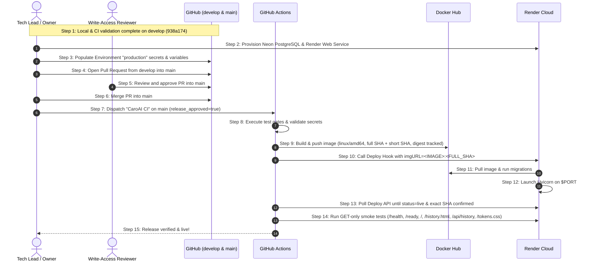

# CaroAI — Production Preflight Audit & Deployment Guide

**Role:** Senior Software Architect, Tech Lead, DevOps Engineer, QA Lead
**Date:** November 7, 2026 (current release snapshot)
**Repository:** `emt0147t/caroAI` (`D:\caro-ai\caroAI`)
**Integration Branch:** `develop` (Phase C merged; not yet promoted to `main`)
**Current Production SHA (`main`):** `42ee035ab42cd4c0bc934699f4d5433ff4b12a83`
**Current Integration SHA (`develop`):** `3d38d4c47ed16e788e99b4836e6157dd5ecc5dcd`
**Historical Pre-Hardening Develop Snapshot:** `2a46000b455f9b9779fd7289c6b22ae080aaa44c` (CI Run [#41502411622](https://github.com/emt0147t/caroAI/actions/runs/41502411622))
**Current Branch Comparison:** `develop` is 85 commits ahead of `main`, 0 behind. PR #62 merged into `develop` at `3d38d4c47ed16e788e99b4836e6157dd5ecc5dcd`.
**Production Branch Baseline:** `main` (`42ee035ab42cd4c0bc934699f4d5433ff4b12a83`)
**Latest Production Release Workflow:** [#42253079008](https://github.com/emt0147t/caroAI/actions/runs/42253079008) (success)
**Historical PR CI Run:** GitHub Actions Run [#41502411622](https://github.com/emt0147t/caroAI/actions/runs/41502411622) on `2a46000`
**Baseline CI Workflow Run:** GitHub Actions Run [#41475666768](https://github.com/emt0147t/caroAI/actions/runs/41475666768) (`status: completed`, `conclusion: success`)
**Historical Preflight Run:** GitHub Actions Run [#41470234191](https://github.com/emt0147t/caroAI/actions/runs/41470234191) on `f796ef9`
**Historical PR #49 Baseline:** PR #49 merged at `6cf9bf08b8fb374645b7ecf79eb7a886ac002ef6` (CI Run [#41462195364](https://github.com/emt0147t/caroAI/actions/runs/41462195364))

---

## 0. Current Production Snapshot — 2026-11-07 (Authoritative)

The detailed checks later in this document were originally captured on November 3, 2026. Where those historical sections still say that the official release is pending, they are superseded by this verified current snapshot. The November 3 live-cloud gameplay observations remain historical evidence and do not satisfy the pending current live production PvP/PvAI acceptance.

| Item | Current state | Details |
|---|---|
| `main` (production) | `42ee035ab42cd4c0bc934699f4d5433ff4b12a83` | Current live Render release |
| `develop` (integration) | `3d38d4c47ed16e788e99b4836e6157dd5ecc5dcd` | PR #62 merged; 85 commits ahead of `main`, 0 behind |
| PR #62 PostgreSQL integration acceptance | Complete in `develop` | Dedicated disposable-PostgreSQL integration test completed; not live production gameplay acceptance |
| Live production PvP/PvAI acceptance | Pending | No current live production gameplay acceptance is claimed |
| Render service | `srv-dbkd2dflk1mc73fd2ukg`, Free plan, Singapore, one instance |
| Live deployment | `dep-dbn02vrncjis73am3dhg` — `live` |
| Exact image | `docker.io/emt0147/caroai:42ee035ab42cd4c0bc934699f4d5433ff4b12a83` |
| Image digest | `sha256:a80c48d0f1433f600ef5d5e2a5dc124f3057cebe716ab9782f238a614f7f35a7` |
| Public URL | [https://caroai-bootstrap-a9e753b33198.onrender.com](https://caroai-bootstrap-a9e753b33198.onrender.com) |
| Release evidence | [GitHub Actions #42253079008](https://github.com/emt0147t/caroAI/actions/runs/42253079008) |

### Production release verification

The release workflow completed successfully and Render confirmed the exact commit-SHA image as live. The release smoke checks returned HTTP 200 for `/health`, `/ready`, `/`, `/history.html`, `/api/history`, and `/tokens.css`. These are endpoint/readiness checks, not a full interactive production gameplay acceptance.

A subsequent Render provider-metrics query returned recent service CPU samples around 0.0021 raw CPU units and memory samples around 70–75 MB. HTTP request-count, HTTP latency, and instance-count series were empty in that query window. These sparse samples are not a load test and do not establish a traffic baseline or SLO.

### Current baseline and release caveats

- Production auto-deploy remains disabled. Continue to use the manual exact-SHA release workflow; do not use a generic Render redeploy while the service's configured `imagePath` remains the historical bootstrap tag.
- Phase C is merged into `develop` through PR #60, and its PostgreSQL-backed acceptance integration test is complete through PR #62 at `3d38d4c...`. Phase C is not promoted to `main` and is not deployed. Current Render production remains on `42ee035...`.
- Live production PvP/PvAI acceptance remains pending. The disposable-PostgreSQL integration test in `develop` does not substitute for acceptance on the live production service.
- The old November 3 audit baselines and pending-release statements below are historical provenance, not current deployment status.
- The 2,000 ms performance threshold remains proposed, not a formally adopted SLO.

---

## 1. Repository Baseline & Git State

| Parameter | Current Audited Value | Status |
|---|---|---|
| **Production Branch** | `main` | `42ee035ab42cd4c0bc934699f4d5433ff4b12a83` (live Render image) |
| **Integration Branch** | `develop` | `3d38d4c47ed16e788e99b4836e6157dd5ecc5dcd` (PR #62 merge commit) |
| **Audit Evidence Baseline SHA** | `938a17408078ca58c9bec6bf42eec09758be6165` | Preserved historical audit metrics baseline |
| **Historical Develop Snapshot** | `2a46000b455f9b9779fd7289c6b22ae080aaa44c` | Pre-hardening develop snapshot (CI Run #41502411622) |
| **Current Production Application Baseline** | `42ee035ab42cd4c0bc934699f4d5433ff4b12a83` | Exact image SHA is live on Render; release run #42253079008 |
| **Documentation Refresh Scope** | `README.md`, `FINAL_ACCEPTANCE_REPORT.md`, `PRODUCTION_PREFLIGHT.md`, `reports/ai-benchmark.md` | Documentation-only; no application source, tests, migrations, Docker configuration, or workflows changed |
| **Main / Develop Relationship** | `develop` is ahead of `main` | 85 commits ahead / 0 behind; PR #62 merged at `3d38d4c47ed16e788e99b4836e6157dd5ecc5dcd` |
| **PR #62 PostgreSQL Integration Acceptance** | Complete in `develop` | Dedicated test against disposable PostgreSQL; live production PvP/PvAI acceptance remains pending |
| **Backup Branch** | `backup/develop-before-pr49-sync-20261102` (`5326543`) | Preserved safely |
| **Ruleset Configuration** | `CaroAI - Protect Develop` allows direct push; `Restrict deletions` and `Block force pushes` remain enabled | Routine engineering proceeds direct-to-develop; `main` requires PR + 1 approval |
| **Baseline CI Verification** | Run [#41475666768](https://github.com/emt0147t/caroAI/actions/runs/41475666768) on commit `938a174` | All 6 test/build jobs succeeded; release skipped as expected |
| **Historical PR CI Run** | Run [#41502411622](https://github.com/emt0147t/caroAI/actions/runs/41502411622) on commit `2a46000` | Historical PR #50 pre-hardening verification |
| **Latest Production Release Verification** | Run [#42253079008](https://github.com/emt0147t/caroAI/actions/runs/42253079008) | Release passed; Render confirmed exact SHA image live and public GET smoke checks passed |
| **Historical CI Verification** | Run [#41470234191](https://github.com/emt0147t/caroAI/actions/runs/41470234191) on commit `f796ef9` | Preflight baseline run preserved for historical audit |

> [!NOTE]
> The `938a174` audit metrics baseline is retained only for historical contributor/commit accounting. The current source and production baseline is `42ee035`. PR #50 and its checks are historical promotion evidence; PR #58 is the current release integration PR and is merged. This document's detailed November 3 audit values must be interpreted as historical where they differ from section 0.

> **Historical sections:** Detailed November 3 preflight procedures and live-cloud gameplay observations are retained for audit provenance. Current Phase C promotion/deployment and live production gameplay status is stated in Section 0 above.

---

## 2. Application Architecture Verification

### 2.1 Component Breakdown & Verification Level

| Component | Code / Local Implementation | Verification Level | Operational Behavior |
|---|---|---|---|
| **FastAPI Backend** | `app/main.py`, `app/api/*` | **Code-verified & Locally tested** | REST endpoints (`/api/games`, `/api/history`, `/health`, `/ready`) enforce server-side game rules, move validation, and turn alternation. |
| **Static Frontend Serving** | Mounted at `/` in `app/main.py` | **Code-verified & Locally tested** | Serves `frontend/Caro_AI/` (`welcome.html`, `trong_tran/index.html`, `tokens.css`) from the same container on port `${PORT:-8000}`. Root `/` serves modern dashboard. |
| **PostgreSQL Persistence** | `app/db/database.py`, `app/db/repositories/*` | **Code-verified & CI-verified** | SQLAlchemy session factory bound to lazily initialized engine with `pool_pre_ping=True`. Persists game states and moves across container restarts. |
| **Database Migrations** | `scripts/migrate_database.py` | **Code-verified & CI-verified** | Explicit versioned SQL files (`000_initial_schema.sql`, `001_games_public_id.sql`) applied in transaction before Uvicorn starts; tracked in `schema_migrations`. |
| **Liveness & Readiness Probes** | `app/api/routes_health.py` | **Code-verified & CI-verified** | `/health` returns `{"status":"ok"}`. `/ready` executes database `SELECT 1` and returns 503 if unreachable. |
| **Containerization** | `Dockerfile`, `docker-compose.yml` | **Code-verified & Locally tested** | Multi-stage build (`python:3.11-slim`), non-root `appuser` (UID 10001), parameterized dynamic port `${PORT:-8000}`, signal-forwarding `exec` startup. |
| **Current Production Instance** | Render Web Service & Neon PostgreSQL | **LIVE / VERIFIED** | Exact image `docker.io/emt0147/caroai:42ee035ab42cd4c0bc934699f4d5433ff4b12a83` is live in deployment `dep-dbn02vrncjis73am3dhg`; release workflow #42253079008 passed endpoint smoke checks. |
| **Official Production Release** | Render Web Service & GitHub Actions release | **LIVE / VERIFIED** | Current production image is commit-pinned at `42ee035...`; release workflow #42253079008 succeeded and Render deployment `dep-dbn02vrncjis73am3dhg` is live. |

---

## 3. Environment Variable Inventory & Cross-Check

Comprehensive cross-check across application source code, Dockerfile, Docker Compose, and CI workflow:

### 3.1 Runtime Environment Variables (Application Code)
| Variable Name | Reading Location | Purpose & Behavior | Default / Production Requirement |
|---|---|---|---|
| **`DATABASE_URL`** | `app/db/database.py`<br>`scripts/migrate_database.py` | Authoritative PostgreSQL connection string. `normalize_database_url()` converts `postgres://` or `postgresql://` prefixes to `postgresql+psycopg2://`. | **Required** in production. Raises `RuntimeError` if missing when DB operations are invoked. |
| **`PORT`** | `Dockerfile` | Container listening port for Uvicorn server and Docker `HEALTHCHECK`. Injected by Render runtime. | Defaults to `8000` via `${PORT:-8000}`. |

### 3.2 Test-Only Environment Variables (Fail-Closed Guards)
| Variable Name | Reading Location | Purpose |
|---|---|---|
| **`CAROAI_TEST_POSTGRES_ALLOWLIST`** | `app/db/testing.py` | Comma-separated `host:port/database` allowlist required before test DDL can execute. |
| **`TEST_DATABASE_URL`** | `tests/test_database_postgres.py`<br>`tests/postgres_suite.py` | Dedicated test PostgreSQL URL. |
| **`CAROAI_TEST_DATABASE_CONFIRMED`** | `tests/test_database_postgres.py`<br>`tests/postgres_suite.py` | Token (`disposable-test-database`) confirming target database is disposable. |

### 3.3 Tooling Environment Variables
| Variable Name | Reading Location | Purpose |
|---|---|---|
| **`CAROAI_SOURCE_SHA`** | `scripts/benchmark_ai_sprint3.py` | Annotates AI benchmark reports with source commit SHA. |

### 3.4 Local Docker Compose Orchestration Variables (Not Read by Python Code)
- `POSTGRES_DB`: Interpolates database name for local Postgres container.
- `POSTGRES_USER`: Interpolates username for local Postgres container.
- `POSTGRES_PASSWORD`: Interpolates password for local Postgres container.
- `POSTGRES_PORT`: Host port mapping for local Postgres (default: 5432).
- `APP_PORT`: Host port mapping for local backend (default: 8000).
- `APP_ENV`: Informational environment tag passed in Compose.
- `FRONTEND_PORT`: Host port mapping for local Nginx (default: 8080).

*No secrets, passwords, or connection strings are printed or committed.*

---

## 4. Docker Hub & Container Image Preflight

| Attribute | Specification | Verification Status |
|---|---|---|
| **Build Architecture** | Multi-stage `python:3.11-slim` | **Locally tested & CI verified** (`caroai:candidate`) |
| **Target Platform** | `platforms: linux/amd64` | **Configured in `.github/workflows/ci-cd.yml`** |
| **Runtime User** | `appuser` (UID 10001, GID 10001) | Non-root runtime enforced in `Dockerfile` |
| **Port Handling** | `ENV PORT=8000`, `--port ${PORT:-8000}` | Dynamically accepts Render port injection |
| **Context Hygiene** | `.dockerignore` excludes `.env`, `.env.*`, `!.env.example`, `.git`, `.github`, `docs/`, `venv/` | Hardened exclusion preventing secret leakage into build context |
| **Docker Hub Registry** | `docker.io/emt0147/caroai` | Verified repository under username `emt0147` |
| **Bootstrap Tag (historical)** | `docker.io/emt0147/caroai:bootstrap-a9e753b33198` | **PUBLISHED / SUPERSEDED** (Original bootstrap image; it is not the current live image) |
| **Automated Tagging Scheme** | Full Commit SHA: `${IMAGE_NAME}:${GITHUB_SHA}`<br>Short SHA: `${IMAGE_NAME}:${GITHUB_SHA:0:12}` | Traceable commit-pinned tags for official releases |
| **Digest Tracking** | Output digest captured via `${{ steps.publish.outputs.digest }}` | Cryptographic content identifier recorded in release step and exported to `$GITHUB_STEP_SUMMARY` |
| **Automated Release Publishing** | Push to `docker.io/emt0147/caroai` via CI/CD on `main` | **VERIFIED** (release workflow #42253079008 published the full-SHA image and triggered Render) |

### 4.1 Final Container Filesystem Inspection Evidence
A final container filesystem inspection was performed against the locally built review image:
- **Image**: `caroai:premerge-review`
- **Image ID**: `sha256:270e19a83a4aecc6e94fc0d90800ce562184b394c0b10cc6836362d9093c11a5`
- **Inspection Command**:
  ```bash
  docker run --rm --entrypoint sh caroai:premerge-review -c "id; echo '--- ENV FILE CHECK ---'; find /app -type f \( -name '.env' -o -name '.env.*' \) -print"
  ```
- **Observed Inspection Output**:
  - Runtime identity: `uid=10001(appuser) gid=10001(appuser)` (non-root execution verified).
  - Environment template: `/app/.env.example` present.
  - Secret file check: No `.env`, `.env.local`, or `.env.production` files found under `/app`.
- **Inspection Scope & Precision Note**:
  - This is a final container filesystem inspection of the built review image.
  - It is not a complete scan of all historical image layers.
  - Gitleaks full Git-history scanning is a separate CI check.
  - No claim is made that all historical image layers have been independently scanned.

---

## 5. Render Web Service & Neon PostgreSQL Preflight

### 5.1 Render Web Service (historical bootstrap and current production)

- **Current Render Service:** **LIVE / VERIFIED**
  - **Service ID:** `srv-dbkd2dflk1mc73fd2ukg`
  - **Public URL:** `https://caroai-bootstrap-a9e753b33198.onrender.com`
  - **Current image:** `docker.io/emt0147/caroai:42ee035ab42cd4c0bc934699f4d5433ff4b12a83`
  - **Deployment:** `dep-dbn02vrncjis73am3dhg` (`live`)
  - **Image digest:** `sha256:a80c48d0f1433f600ef5d5e2a5dc124f3057cebe716ab9782f238a614f7f35a7`
  - **Instance Type / Region:** Free / Singapore
  - **Health Check Path:** `/ready`
- **Original Bootstrap Image:** `docker.io/emt0147/caroai:bootstrap-a9e753b33198`; historical published artifact, superseded by the current commit-pinned release image.
- **Official Production Release:** **LIVE / VERIFIED**
  - Release workflow [#42253079008](https://github.com/emt0147t/caroAI/actions/runs/42253079008) published the commit-SHA image and triggered Render.
  - Render confirmed the exact SHA image as live; six public smoke endpoints returned HTTP 200.
- **Downtime Management:** Render zero-downtime deploy is a platform capability designed to boot the new container, validate `/ready`, drain the old container with SIGTERM, and cut over traffic. This behavior is conditional and has NOT been empirically tested or verified for this application on production.

### 5.2 Neon Serverless PostgreSQL
- **Provider:** Neon Serverless PostgreSQL
- **Project:** `caroai-demo`
- **Region:** AWS Singapore (`ap-southeast-1`)
- **Plan:** Free
- **PostgreSQL Version:** 18
- **Database Name:** `neondb`
- **Branch:** `production`
- **Connection Mode:** Direct (non-pooler) connection. Neon provides both pooled (`-pooler` endpoint on port 5432/6543) and direct connections. The deployed CaroAI production service uses the direct connection.
- **Connection Security & Parameters:** Mandates TLS encryption (`sslmode=require`) and channel binding (`channel_binding=require`).
- **Configuration Security:** `DATABASE_URL` is configured directly within the Render Web Service environment settings. (The raw hostname, username, password, and connection string are strictly confidential and never printed, committed, or documented).
- **Internal Pooling Distinction:** The FastAPI application maintains its own internal connection pool via SQLAlchemy with `pool_pre_ping=True`, so it connects directly to Neon without an external transaction pooler.
- **Migration Execution:** Startup migration runner (`scripts/migrate_database.py`) applied `000_initial_schema.sql` and `001_games_public_id.sql` idempotently, tracked via `schema_migrations`. Render startup confirmed schema up to date.
- **Cloud Persistence Verification:** **PASS**.
  - Interactive PvP and PvAI match creation succeeded against live database.
  - Minimax AI move calculation returned player O.
  - Match details and history were verified via `/api/history`.
  - Web Service restart was executed on Render. Following restart completion, both PvP and PvAI games remained fully retrievable (`POST-RESTART PERSISTENCE: PASS`).

---

## 6. Production Read-Only Smoke Tests & Deployment Verification

### 6.1 Verified Endpoints on Current Production Deployment
The current commit-pinned production deployment at `https://caroai-bootstrap-a9e753b33198.onrender.com` was verified across core routes by release workflow #42253079008:

| Target Endpoint | Description | Expected HTTP Status | Verification Status | Verification Focus |
|---|---|---|---|---|
| **`GET /health`** | Liveness probe | `200 OK` | **PASS (HTTP 200)** | Fast-path application process availability. |
| **`GET /ready`** | Database readiness probe | `200 OK` | **PASS (HTTP 200)** | Neon PostgreSQL connection pool active; `SELECT 1` succeeds. |
| **`GET /`** | Root UI dashboard | `200 OK` | **PASS (HTTP 200)** | Static file serving active; loads modern gaming hub. |
| **`GET /history.html`** | History UI page | `200 OK` | **PASS (HTTP 200)** | Historical matches browser UI asset availability. |
| **`GET /api/history`** | History REST API | `200 OK` | **PASS (HTTP 200)** | REST API routing and JSON response serialization from Neon PostgreSQL. |
| **`GET /tokens.css`** | Design tokens | `200 OK` | **PASS (HTTP 200)** | Static CSS stylesheet asset serving. |

### 6.2 Historical Live Gameplay and Durability Evidence (pre-current-release)
- **PvP Game Lifecycle:** Verified creation, moves, and victory detection against live backend.
- **PvAI Move Execution:** Verified Minimax AI calculation returning player O move.
- **Production History Retrieval:** Verified game details and moves retrievable from Neon PostgreSQL via `/api/history`.
- **Render Service Restart Durability:** Render Web Service restart completed; both PvP and PvAI games remained intact and accessible after restart (`POST-RESTART PERSISTENCE: PASS`).

### 6.3 Automated CI Smoke Test Design Principles:
1. **HTTP GET Only:** Strictly read-only; does not create games, make moves, or modify database records.
2. **Exponential / Retry Loop:** Up to 12 attempts with 5-second intervals (60-second window) to accommodate warm-up.
3. **Transparent Logging:** Outputs requested path, description, HTTP status code, and attempt count.
4. **Zero Credential Exposure:** Secrets and authorization headers are never logged or echoed.
5. **Fail-Closed:** Any endpoint failing after 12 retries aborts the workflow with non-zero exit code.

---

## 7. GitHub Production Environment Preflight

Configuration entered in repository settings (**Settings** → **Environments** → **`production`**):

| Secret / Variable Name | Type | Current Status | Operational Role |
|---|---|---|---|
| **`DOCKERHUB_USERNAME`** | Secret | Operationally validated by release workflow #42253079008 | Docker Hub account username used by the successful image publish. |
| **`DOCKERHUB_TOKEN`** | Secret | Operationally validated by release workflow #42253079008 | Registry credential used by the successful image publish; raw value remains confidential. |
| **`RENDER_DEPLOY_HOOK`** | Secret | Operationally validated by release workflow #42253079008 | Triggered the exact-SHA Render deployment. |
| **`RENDER_API_KEY`** | Secret | Operationally validated by release workflow #42253079008 | Used to poll Render deployment status. |
| **`RENDER_SERVICE_ID`** | Secret | Operationally validated by release workflow #42253079008 | Resolved Render service `srv-dbkd2dflk1mc73fd2ukg`. |
| **`CAROAI_PUBLIC_URL`** | Variable | Operationally validated by release workflow #42253079008 | Workflow verified a non-empty HTTPS origin with hostname and no credentials, path, query, or fragment. |

*Status note: Production release workflow #42253079008 successfully exercised the five `production` secrets (registry login/publish, Render deploy hook, Render API polling, and service identification) and validated `CAROAI_PUBLIC_URL` format. This confirms operational use at release time, not the disclosure or persistence of any secret value.

### 7.1 Environment Protection & Approval Gate Review
- **Environment Approval Gate:** While `.github/workflows/ci-cd.yml` references `environment: name: production`, GitHub Actions does not enforce manual approvals unless configured by the repository owner. Required Reviewers setting: **Unconfirmed / awaiting verification** under **Settings → Environments → `production`** (do not claim configured unless independently confirmed).
- **Deployment Branch Policy:** Deployment branch rules restricting deployments exclusively to `main`: **Unconfirmed / awaiting verification** (do not claim configured unless independently confirmed).

---

## 8. Release Sequence & Promotion Flow



### 8.1 Promotion Rules & Branch Gating
Direct push to `main` is strictly prohibited by repository rulesets (`main` enforces Pull Request reviews with at least 1 approval). Promotion from `develop` to `main` must follow the formal Pull Request sequence:
1. Open a Pull Request from `develop` to `main`.
2. A write-access team member reviews and submits an approving review.
3. The PR is merged into `main`.
4. Triggering the production release is a separate subsequent manual action via `workflow_dispatch` on `main` with `release_approved=true`.

---

## 9. Rollback & Disaster Recovery Procedures

1. **Instant Cloud Rollback (Render Dashboard):**
   - Navigate to Render Web Service → **Deploys**.
   - Select the previously healthy deployment and click **Rollback to this deploy**.
   - Render immediately points traffic to the previous Docker container image.
2. **Git Rollback:**
   - Revert the offending commit on `develop`, verify tests, promote to `main` via Pull Request and review approval, and re-dispatch the release workflow.
3. **Database Schema Backward Compatibility:**
   - Migrations are strictly additive (`CREATE TABLE IF NOT EXISTS`, `ALTER TABLE ... ADD COLUMN IF NOT EXISTS`). Previous application images remain fully compatible with the schema.

---

## 10. Remaining Post-Release Acceptance Work

1. **Documentation baseline:** this preflight and the accompanying README, Final Acceptance Report, and benchmark report now reference the current production release; review this documentation PR before merging.
2. **Phase C promotion:** Phase C [PR #60](https://github.com/emt0147t/caroAI/pull/60) and the real-PostgreSQL acceptance-runner test [PR #62](https://github.com/emt0147t/caroAI/pull/62) are merged into `develop`; PR #62 merged at `3d38d4c47ed16e788e99b4836e6157dd5ecc5dcd`. The integration test is complete. Phase C is not promoted to `main` or deployed; live production PvP/PvAI acceptance remains pending.
3. **Production PvP/PvAI acceptance:** only run after the reviewed Phase C release deploys its QA route and migration. Verify win state, AI move legality, reload/history persistence, and exact-run cleanup; never run destructive cleanup outside its run ID.
4. **Observability activation:** decide whether to configure a dedicated `CAROAI_METRICS_TOKEN`, deploy an authenticated scraper, and configure notification routing. Alert rules in the repo are templates, not active alerts.
5. **Capacity/SLO decision:** gather production traffic evidence before enabling IMPOSSIBLE time budgets or concurrency limits. The 2,000 ms value is a proposed reference, not an adopted SLO.

