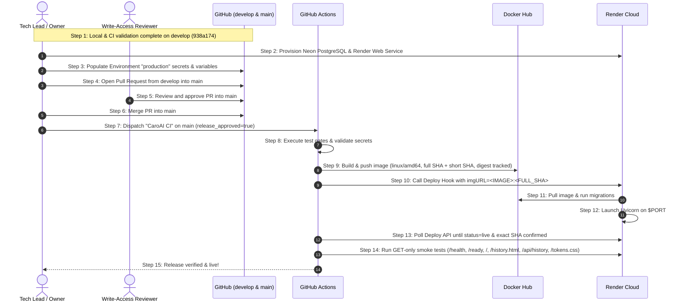

# CaroAI — Production Preflight Audit & Deployment Guide

**Role:** Senior Software Architect, Tech Lead, DevOps Engineer, QA Lead
**Date:** November 2, 2026
**Repository:** `emt0147t/caroAI` (`D:\caro-ai\caroAI`)
**Integration Branch:** `develop`
**Audit Evidence Baseline SHA:** `938a17408078ca58c9bec6bf42eec09758be6165`
**Reconciliation Develop HEAD:** `2a46000b455f9b9779fd7289c6b22ae080aaa44c` (at time of reconciliation task)
**Production Branch Baseline:** `main` (`d444119d5eb757e364f904bb9eacddd27e14e507`)
**Baseline CI Workflow Run:** GitHub Actions Run [#41475666768](https://github.com/emt0147t/caroAI/actions/runs/41475666768) (`status: completed`, `conclusion: success`)
**PR-Triggered CI Run:** GitHub Actions Run [#41502411622](https://github.com/emt0147t/caroAI/actions/runs/41502411622) on PR #50 (`2a46000`)
**Historical Preflight Run:** GitHub Actions Run [#41470234191](https://github.com/emt0147t/caroAI/actions/runs/41470234191) on `f796ef9`
**Historical PR #49 Baseline:** PR #49 merged at `6cf9bf08b8fb374645b7ecf79eb7a886ac002ef6` (CI Run [#41462195364](https://github.com/emt0147t/caroAI/actions/runs/41462195364))

---

## 1. Repository Baseline & Git State

| Parameter | Current Audited Value | Status |
|---|---|---|
| **Current Branch** | `develop` | Aligned with `origin/develop` |
| **Audit Evidence Baseline SHA** | `938a17408078ca58c9bec6bf42eec09758be6165` | Preserved historical audit metrics baseline |
| **Current develop HEAD** | `2a46000b455f9b9779fd7289c6b22ae080aaa44c` | Recorded at time of reconciliation task |
| **Remote Branch SHA** | `2a46000b455f9b9779fd7289c6b22ae080aaa44c` | In exact sync (`origin/develop`) |
| **Working Tree Status** | Clean (tracked changes audited) | Zero uncommitted external files |
| **Main / Develop Relationship** | `develop` is 388 commits ahead, 0 behind `main` | 339 non-merge commits, 49 merge commits (at baseline `938a174`); strictly linear ancestry |
| **Backup Branch** | `backup/develop-before-pr49-sync-20261102` (`5326543`) | Preserved safely |
| **Ruleset Configuration** | `CaroAI - Protect Develop` allows direct push; `Restrict deletions` and `Block force pushes` remain enabled | Routine engineering proceeds direct-to-develop; `main` requires PR + 1 approval |
| **Baseline CI Verification** | Run [#41475666768](https://github.com/emt0147t/caroAI/actions/runs/41475666768) on commit `938a174` | All 6 test/build jobs succeeded; release skipped as expected |
| **PR CI Verification** | Run [#41502411622](https://github.com/emt0147t/caroAI/actions/runs/41502411622) on commit `2a46000` | PR #50 verification pipeline executed |
| **Historical CI Verification** | Run [#41470234191](https://github.com/emt0147t/caroAI/actions/runs/41470234191) on commit `f796ef9` | Preflight baseline run preserved for historical audit |

> [!NOTE]
> The historical audit metrics baseline (`938a174`) is preserved for contributor and commit accounting. Subsequent maintenance commits (`a9e753b`, `2a46000`, and reconciliation edits) are tracked separately. At the time of this reconciliation task, `develop` HEAD is `2a46000b455f9b9779fd7289c6b22ae080aaa44c`.

---

## 2. Application Architecture Verification

### 2.1 Component Breakdown & Verification Level

| Component | Code / Local Implementation | Verification Level | Operational Behavior |
|---|---|---|---|
| **FastAPI Backend** | `app/main.py`, `app/api/*` | **Code-verified & Locally tested** | REST endpoints (`/api/games`, `/api/history`, `/health`, `/ready`) enforce server-side game rules, move validation, and turn alternation. |
| **Static Frontend Serving** | Mounted at `/` in `app/main.py` | **Code-verified & Locally tested** | Serves `frontend/Caro_AI/` (`welcome.html`, `trong_tran/index.html`, `tokens.css`) from the same container on port `${PORT:-8000}`. Root `/` serves modern dashboard. |
| **PostgreSQL Persistence** | `app/db/database.py`, `app/db/repositories/*` | **Code-verified & CI-verified** | SQLAlchemy session factory bound to lazily initialized engine with `pool_pre_ping=True`. Persists game states and moves across container restarts. |
| **Database Migrations** | `scripts/migrate_database.py` | **Code-verified & CI-verified** | Explicit versioned SQL files (`000_initial_schema.sql`, `001_games_public_id.sql`) applied in transaction before Uvicorn starts; tracked in `schema_migrations`. |
| **Liveness & Readiness Probes** | `app/api/routes_health.py` | **Code-verified & CI-verified** | `/health` returns `{"status":"ok"}`. `/ready` executes database `SELECT 1` and returns 503 if unreachable. |
| **Containerization** | `Dockerfile`, `docker-compose.yml` | **Code-verified & Locally tested** | Multi-stage build (`python:3.11-slim`), non-root `appuser` (UID 10001), parameterized dynamic port `${PORT:-8000}`, signal-forwarding `exec` startup. |
| **Bootstrap Live Instance** | Render Web Service & Neon PostgreSQL | **LIVE & VERIFIED** | Bootstrap deployment verified live at `https://caroai-bootstrap-a9e753b33198.onrender.com`. Migrations applied; `/ready` probe and persistence across restart verified (`POST-RESTART PERSISTENCE: PASS`). |
| **Official Production Release** | Render Web Service & GitHub Actions release | **PENDING / NOT RUN** | Official automated release workflow on protected `main` has not run; full-SHA/short-SHA release tags pending promotion of PR #50. |

---

## 3. Environment Variable Inventory & Cross-Check

Comprehensive cross-check across application source code, Dockerfile, Docker Compose, and CI workflow:

### 3.1 Runtime Environment Variables (Application Code)
| Variable Name | Reading Location | Purpose & Behavior | Default / Production Requirement |
|---|---|---|---|
| **`DATABASE_URL`** | `app/db/database.py` `scripts/migrate_database.py` | Authoritative PostgreSQL connection string. `normalize_database_url()` converts `postgres://` or `postgresql://` prefixes to `postgresql+psycopg2://`. | **Required** in production. Raises `RuntimeError` if missing when DB operations are invoked. |
| **`PORT`** | `Dockerfile` | Container listening port for Uvicorn server and Docker `HEALTHCHECK`. Injected by Render runtime. | Defaults to `8000` via `${PORT:-8000}`. |

### 3.2 Test-Only Environment Variables (Fail-Closed Guards)
| Variable Name | Reading Location | Purpose |
|---|---|---|
| **`CAROAI_TEST_POSTGRES_ALLOWLIST`** | `app/db/testing.py` | Comma-separated `host:port/database` allowlist required before test DDL can execute. |
| **`TEST_DATABASE_URL`** | `tests/test_database_postgres.py` `tests/postgres_suite.py` | Dedicated test PostgreSQL URL. |
| **`CAROAI_TEST_DATABASE_CONFIRMED`** | `tests/test_database_postgres.py` `tests/postgres_suite.py` | Token (`disposable-test-database`) confirming target database is disposable. |

### 3.3 Tooling Environment Variables
| Variable Name | Reading Location | Purpose |
|---|---|---|
| **`CAROAI_SOURCE_SHA`** | `scripts/benchmark_ai_sprint3.py` | Annotates AI benchmark reports with source commit SHA. |

### 3.4 Local Docker Compose Orchestration Variables (Not Read by Python Code)
- `POSTGRES_DB`: Interpolates database name for local Postgres container.
- `POSTGRES_USER`: Interpolates username for local Postgres container.
- `POSTGRES_PASSWORD`: Interpolates password for local Postgres container.
- `POSTGRES_PORT`: Host port mapping for local Postgres (default: 5432).
- `APP_PORT`: Host port mapping for local backend (default: 8000).
- `APP_ENV`: Informational environment tag passed in Compose.
- `FRONTEND_PORT`: Host port mapping for local Nginx (default: 8080).

*No secrets, passwords, or connection strings are printed or committed.*

---

## 4. Docker Hub & Container Image Preflight

| Attribute | Specification | Verification Status |
|---|---|---|
| **Build Architecture** | Multi-stage `python:3.11-slim` | **Locally tested & CI verified** (`caroai:candidate`) |
| **Target Platform** | `platforms: linux/amd64` | **Configured in `.github/workflows/ci-cd.yml`** |
| **Runtime User** | `appuser` (UID 10001, GID 10001) | Non-root runtime enforced in `Dockerfile` |
| **Port Handling** | `ENV PORT=8000`, `--port ${PORT:-8000}` | Dynamically accepts Render port injection |
| **Context Hygiene** | `.dockerignore` excludes `.env`, `.env.*`, `!.env.example`, `.git`, `.github`, `docs/`, `venv/` | Hardened exclusion preventing secret leakage into build context |
| **Docker Hub Registry** | `docker.io/emt0147/caroai` | Verified repository under username `emt0147` |
| **Bootstrap Tag** | `docker.io/emt0147/caroai:bootstrap-a9e753b33198` | **VERIFIED / LIVE** (Manually published; powering live bootstrap service) |
| **Automated Tagging Scheme** | Full Commit SHA: `${IMAGE_NAME}:${GITHUB_SHA}` Short SHA: `${IMAGE_NAME}:${GITHUB_SHA:0:12}` | Traceable commit-pinned tags for official releases |
| **Digest Tracking** | Output digest captured via `${{ steps.publish.outputs.digest }}` | Cryptographic content identifier recorded in release step and exported to `$GITHUB_STEP_SUMMARY` |
| **Automated Release Publishing** | Push to `docker.io/emt0147/caroai` via CI/CD on `main` | **PENDING / NOT RUN** (Automated release workflow on `main` has not run) |

---

## 5. Render Web Service & Neon PostgreSQL Preflight

### 5.1 Render Web Service (Bootstrap & Production)
- **Bootstrap Service Status:** **LIVE & VERIFIED**
  - **Service ID:** `srv-dbkd2dflk1mc73fd2ukg`
  - **Public URL:** `https://caroai-bootstrap-a9e753b33198.onrender.com`
  - **Bootstrap Image:** `docker.io/emt0147/caroai:bootstrap-a9e753b33198`
  - **Instance Type:** Free
  - **Health Check Path:** `/ready` (guarantees ASGI server liveness and database `SELECT 1` connectivity)
  - **Observed Behavior:** Render pulled image, executed migrations on startup (reporting schema up to date), and successfully served all endpoints (`/health`, `/ready`, `/`, `/history.html`, `/api/history`, `/tokens.css`).
- **Official Production Release:** **PENDING / NOT RUN**
  - Release workflow on `main` is gated and has not run.
  - Automated deployment via Render Deploy Hook (`RENDER_DEPLOY_HOOK`) with commit-SHA tagged images remains pending PR #50 merge to `main`.
- **Downtime Management:** Render zero-downtime deploy is a platform capability designed to boot the new container, validate `/ready`, drain the old container with SIGTERM, and cut over traffic. Note: This behavior is conditional (subject to single-container limits and persistent-disk attachment constraints), and zero-downtime cutover has NOT been empirically tested or verified for this application on production.

### 5.2 Neon Serverless PostgreSQL
- **Provider:** Neon Serverless PostgreSQL
- **Project:** `caroai-demo`
- **Region:** AWS Singapore (`ap-southeast-1`)
- **Plan:** Free
- **PostgreSQL Version:** 18
- **Database Name:** `neondb`
- **Branch:** `production`
- **Configuration:** `DATABASE_URL` is configured directly within the Render Web Service environment settings. (The raw connection string, password, and host credentials are strictly confidential and never stored in repository files or documentation).
- **TLS / SSL Policy:** Neon mandates TLS encryption for all connections (`sslmode=require`). Application `normalize_database_url()` transparently configures `psycopg2-binary` connection parameters.
- **Migration Execution:** Startup migration runner (`scripts/migrate_database.py`) applied `000_initial_schema.sql` and `001_games_public_id.sql` idempotently, tracked via `schema_migrations`. Render startup confirmed schema up to date.
- **Cloud Persistence Verification:** **PASS**.
  - Interactive PvP and PvAI match creation succeeded against live database.
  - Minimax AI move calculation returned player O.
  - Match details and history were verified via `/api/history`.
  - Web Service restart was executed on Render. Following restart completion, both PvP and PvAI games remained fully retrievable (`POST-RESTART PERSISTENCE: PASS`).

---

## 6. Production Read-Only Smoke Tests & Deployment Verification

### 6.1 Verified Endpoints on Live Bootstrap Deployment
The bootstrap service at `https://caroai-bootstrap-a9e753b33198.onrender.com` was verified across core routes:

| Target Endpoint | Description | Expected HTTP Status | Verification Status | Verification Focus |
|---|---|---|---|---|
| **`GET /health`** | Liveness probe | `200 OK` | **PASS (HTTP 200)** | Fast-path application process availability. |
| **`GET /ready`** | Database readiness probe | `200 OK` | **PASS (HTTP 200)** | Neon PostgreSQL connection pool active; `SELECT 1` succeeds. |
| **`GET /`** | Root UI dashboard | `200 OK` | **PASS (HTTP 200)** | Static file serving active; loads modern gaming hub. |
| **`GET /history.html`** | History UI page | `200 OK` | **PASS (HTTP 200)** | Historical matches browser UI asset availability. |
| **`GET /api/history`** | History REST API | `200 OK` | **PASS (HTTP 200)** | REST API routing and JSON response serialization from Neon PostgreSQL. |
| **`GET /tokens.css`** | Design tokens | `200 OK` | **PASS (HTTP 200)** | Static CSS stylesheet asset serving. |

### 6.2 Verified Gameplay and Durability Tests
- **PvP Game Lifecycle:** Verified creation, moves, and victory detection against live backend.
- **PvAI Move Execution:** Verified Minimax AI calculation returning player O move.
- **Production History Retrieval:** Verified game details and moves retrievable from Neon PostgreSQL via `/api/history`.
- **Render Service Restart Durability:** Render Web Service restart completed; both PvP and PvAI games remained intact and accessible after restart (`POST-RESTART PERSISTENCE: PASS`).

### 6.3 Automated CI Smoke Test Design Principles:
1. **HTTP GET Only:** Strictly read-only; does not create games, make moves, or modify database records.
2. **Exponential / Retry Loop:** Up to 12 attempts with 5-second intervals (60-second window) to accommodate warm-up.
3. **Transparent Logging:** Outputs requested path, description, HTTP status code, and attempt count.
4. **Zero Credential Exposure:** Secrets and authorization headers are never logged or echoed.
5. **Fail-Closed:** Any endpoint failing after 12 retries aborts the workflow with non-zero exit code.

---

## 7. GitHub Production Environment Preflight

Configuration entered in repository settings (**Settings** → **Environments** → **`production`**):

| Secret / Variable Name | Type | Current Status | Operational Role |
|---|---|---|---|
| **`DOCKERHUB_USERNAME`** | Secret | Entered by owner (pending release job validation) | Docker Hub account username (`emt0147`) for registry login. |
| **`DOCKERHUB_TOKEN`** | Secret | Entered by owner (pending release job validation) | Personal Access Token with Read/Write registry scope. |
| **`RENDER_DEPLOY_HOOK`** | Secret | Entered by owner (pending release job validation) | Render Web Service Deploy Hook URL. |
| **`RENDER_API_KEY`** | Secret | Entered by owner (pending release job validation) | Personal API key for polling Render deploy status API. |
| **`RENDER_SERVICE_ID`** | Secret | Entered by owner (pending release job validation) | Service identifier (`srv-dbkd2dflk1mc73fd2ukg`) from Render Web Service. |
| **`CAROAI_PUBLIC_URL`** | Variable | Entered by owner (pending release job validation) | Public HTTPS URL (bootstrap: `https://caroai-bootstrap-a9e753b33198.onrender.com`). |

*Status note: Environment secrets were entered by the repository owner in GitHub Settings → Environments → `production`. However, because the production release job is skipped during standard push/PR CI runs, these secrets have not yet been validated by a successful executing release job.*

### 7.1 Environment Protection & Approval Gate Review
- **Environment Approval Gate:** While `.github/workflows/ci-cd.yml` references `environment: name: production`, GitHub Actions does not enforce manual approvals unless configured by the repository owner. Required Reviewers setting: **Unconfirmed / awaiting verification** under **Settings → Environments → `production`** (do not claim configured unless independently confirmed).
- **Deployment Branch Policy:** Deployment branch rules restricting deployments exclusively to `main`: **Unconfirmed / awaiting verification** (do not claim configured unless independently confirmed).

---

## 8. Release Sequence & Promotion Flow

### 8.1 Promotion Rules & Branch Gating
Direct push to `main` is strictly prohibited by repository rulesets (`main` enforces Pull Request reviews with at least 1 approval). Promotion from `develop` to `main` must follow the formal Pull Request sequence:
1. Open a Pull Request from `develop` to `main`.
2. A write-access team member reviews and submits an approving review.
3. The PR is merged into `main`.
4. Triggering the production release is a separate subsequent manual action via `workflow_dispatch` on `main` with `release_approved=true`.

---

## 9. Rollback & Disaster Recovery Procedures

1. **Instant Cloud Rollback (Render Dashboard):**
   - Navigate to Render Web Service → **Deploys**.
   - Select the previously healthy deployment and click **Rollback to this deploy**.
   - Render immediately points traffic to the previous Docker container image.
2. **Git Rollback:**
   - Revert the offending commit on `develop`, verify tests, promote to `main` via Pull Request and review approval, and re-dispatch the release workflow.
3. **Database Schema Backward Compatibility:**
   - Migrations are strictly additive (`CREATE TABLE IF NOT EXISTS`, `ALTER TABLE ... ADD COLUMN IF NOT EXISTS`). Previous application images remain fully compatible with the schema.

---

## 10. Remaining Steps Prior to Official Release

1. **Bootstrap Deployment Verified:** Bootstrap Web Service (`srv-dbkd2dflk1mc73fd2ukg`) is LIVE at `https://caroai-bootstrap-a9e753b33198.onrender.com` connected to Neon PostgreSQL, with schema migrations applied and post-restart persistence verified (`POST-RESTART PERSISTENCE: PASS`).
2. **GitHub Environment Secrets:** Secrets and variables in Environment `production` have been entered by the repository owner, but remain to be validated by an executing release job.
3. **PR #50 Promotion to `main`:** Pull Request #50 from `develop` into `main` must be reviewed by a write-access team member, approved, and merged.
4. **Trigger Official Production Release:** Following merge of PR #50, dispatch `CaroAI CI/CD` on `main` with `release_approved=true` to publish traceable commit-SHA images to Docker Hub and trigger the official deployment hook.
